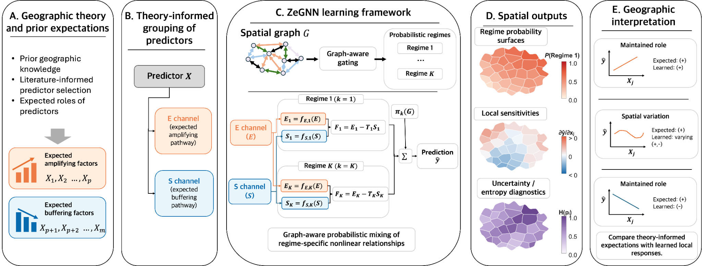

# ZeGNN

**ZeGNN** is a thermodynamic-inspired graph neural network for learning regime-dependent spatial relationships through structured Burden–Capacity pathways and graph-aware probabilistic gating.

**Associated manuscript:** *Learning Regime-Dependent Spatial Relationships with a Thermodynamic-Inspired Graph Neural Network*  
Sooyoung Lim, Zhenlong Li, and Zi-Kui Liu.



## Installation

```bash
git clone https://github.com/Swimminglim/ZeGNN.git
cd ZeGNN
pip install -r requirements.txt
```

## Simulations

Run the three simulation experiments described in the manuscript and supporting information:

```bash
python scripts/run_global_linear.py
python scripts/run_local_linear.py
python scripts/run_nonlinear.py
```

The scripts generate their own simulation datasets. Results are saved in `GLOBAL_Linear/`, `Local Linear/`, and `RESULT_NonLinear/`.

## Empirical applications

The empirical analysis includes **Housing**, **Mental Health**, and **PM2.5**. Place the three input CSV files in `data/`:

```text
data/
├── kc_house_data.csv
├── Mental_health.csv
└── PM25_June2023_Mean.csv
```

Run the ZeGNN empirical analyses from the repository root:

```bash
python scripts/run_empirical_zegnn.py --manifest inputs/ZENTROPY_sweep.csv --out_root outputs/empirical
```

The empirical script performs ZeGNN model fitting and evaluation for the three case studies, including cross-validation summaries and model diagnostics. The simulation scripts include the benchmark comparisons used for the controlled experiments.

## Files

```text
scripts/           ZeGNN simulation and empirical experiments
data/              Input datasets
inputs/            Empirical model settings
figures/           Conceptual framework
requirements.txt   Python dependencies
```

Study-area descriptions, variable definitions, and model evaluation protocols are provided in the manuscript and supporting information.
